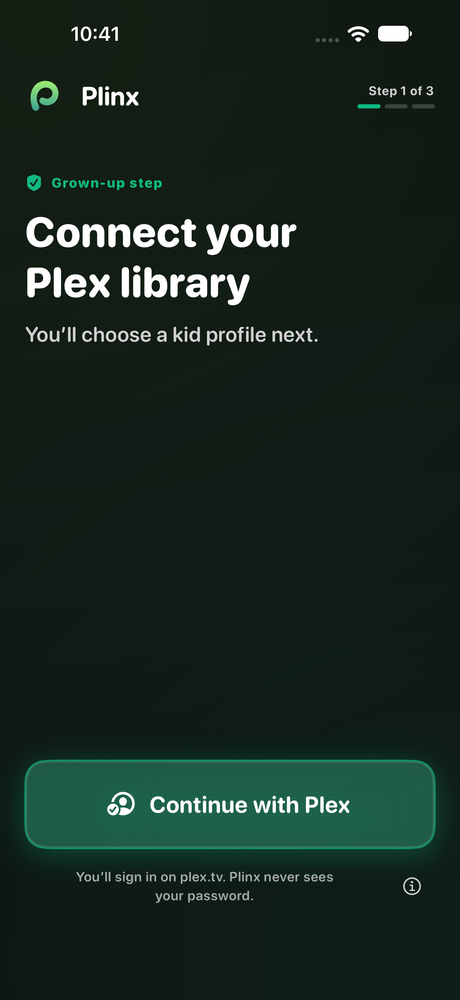
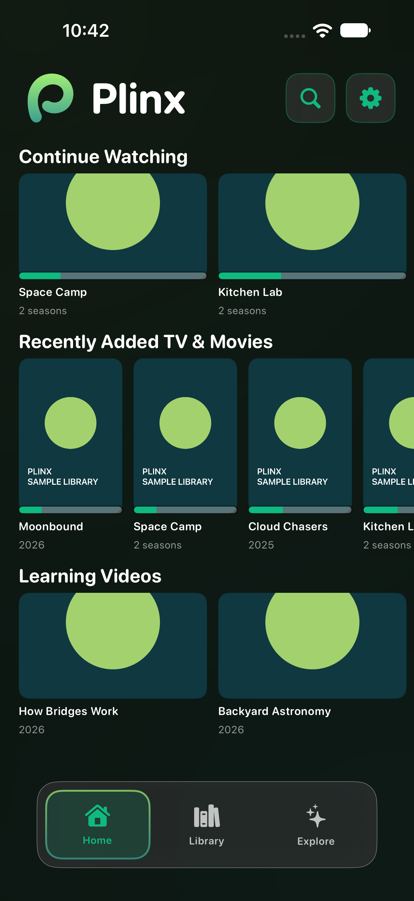

# Plinx

Plinx is a parent-managed Plex client for family media. It supports iPhone,
iPad, and Apple TV in the 2026.08 release. Parents choose visible libraries and
rating limits behind a parental gate; families can browse, search, and play
approved media. Downloads and offline playback are available on iPhone and
iPad only.

Youtarr integration is optional and parent-configured. It provides filtered
video discovery and requests inside Plinx, while kid-facing screens keep
external links out of the experience.

## Try the sample library

On iPhone or iPad, open **Sign-in information** on the connection screen, then
choose **Explore the Demo Library**. Browse sample movies and episodes, play
bundled videos, and try downloads without a Plex account or Internet access.
The demo parental PIN is **2468**; demo settings are separate from family
settings. Apple TV setup uses a Plex account.

## A look inside

These captures show the built-in sample library, with original sample artwork
and video rather than a family's media. See the [product tour](docs/user/product-tour.md)
for the iPad experience and playback controls.

  
  

## Develop locally

Plinx compiles sources from a sibling `../strimr` checkout. Keep your fork as
Strimr's `origin` and the original project as `upstream`; build the exact
revision and branch recorded in `config/release-dependencies.env`.
Follow [development setup](docs/development/setup.md) and run
`./scripts/verify_strimr_integration_contract.sh --full` before a paired build.
The [branch-pairing guide](docs/development/branch-pairing.md) explains how to
keep development and stable patches aligned.

## Documentation

The full user, parent, contributor, architecture, release, and maintenance
guide is published at [bballdavis.github.io/Plinx](https://bballdavis.github.io/Plinx/).
Start with the [user guide](docs/user/getting-started.md), [Apple TV guide](docs/user/apple-tv.md), or [developer setup](docs/development/setup.md).

## Privacy, support, and license

Plinx does not collect analytics, crash reports, or usage telemetry. Read the
[Privacy Policy](PRIVACY_POLICY.md), report reproducible issues through
[GitHub Issues](https://github.com/bballdavis/Plinx/issues), and see
[LICENSE](LICENSE) for GPL-3.0 terms.
