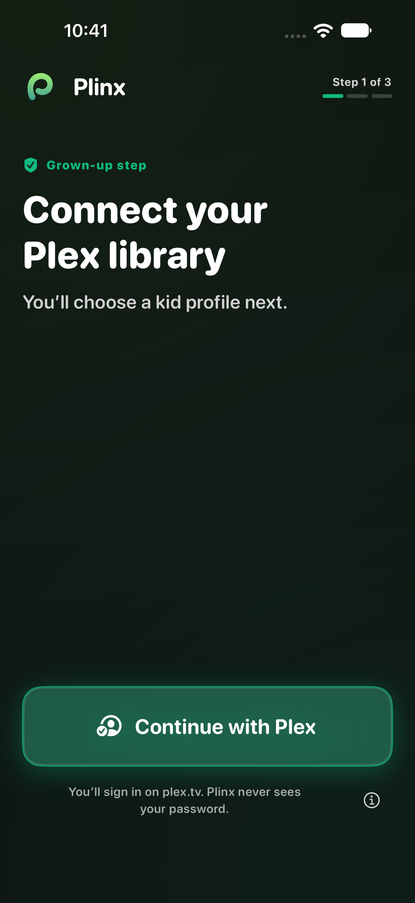
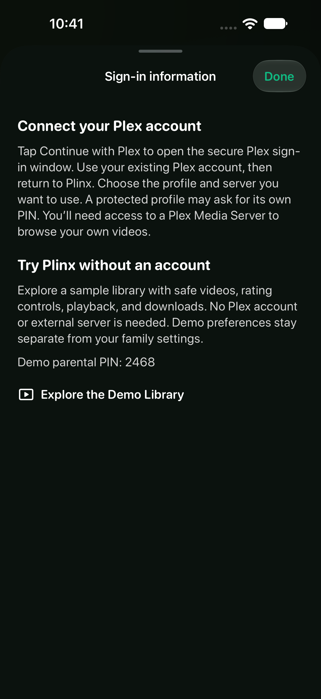
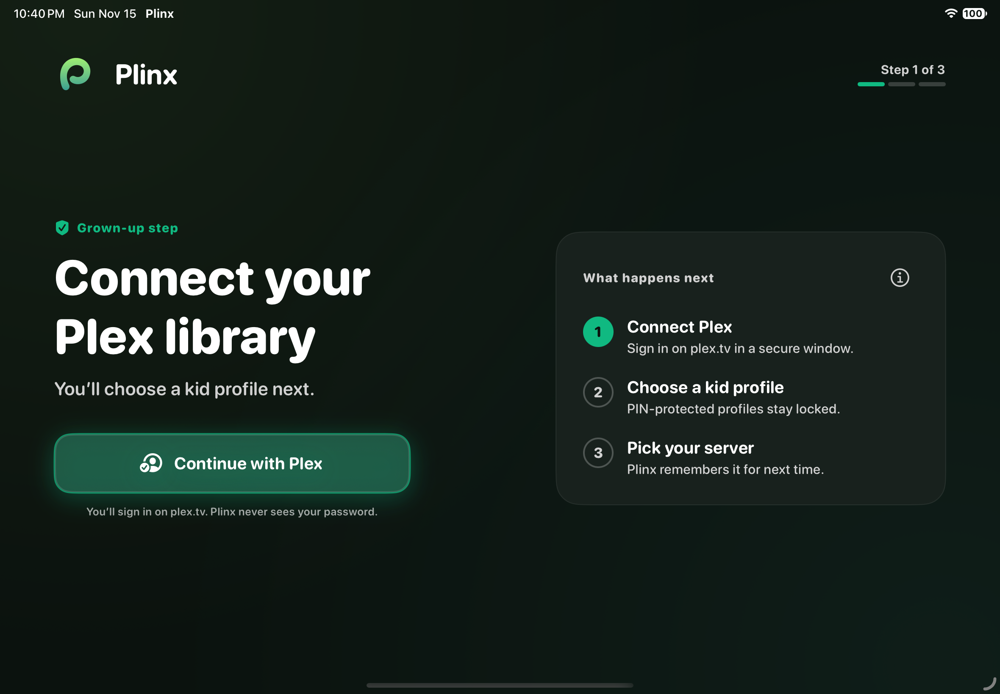
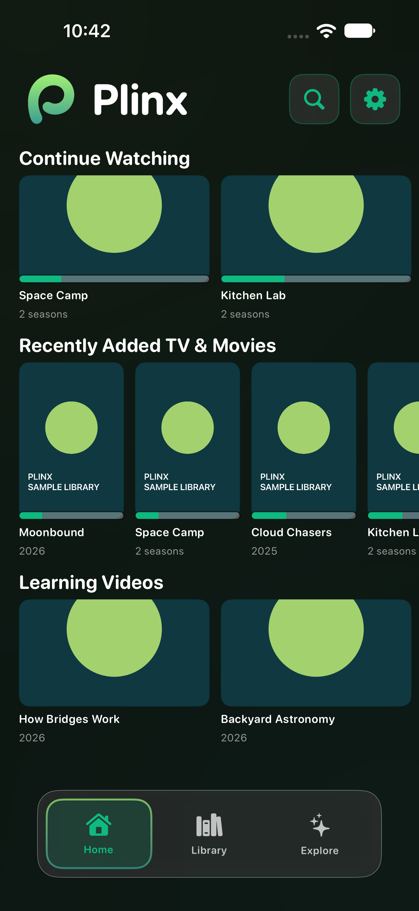
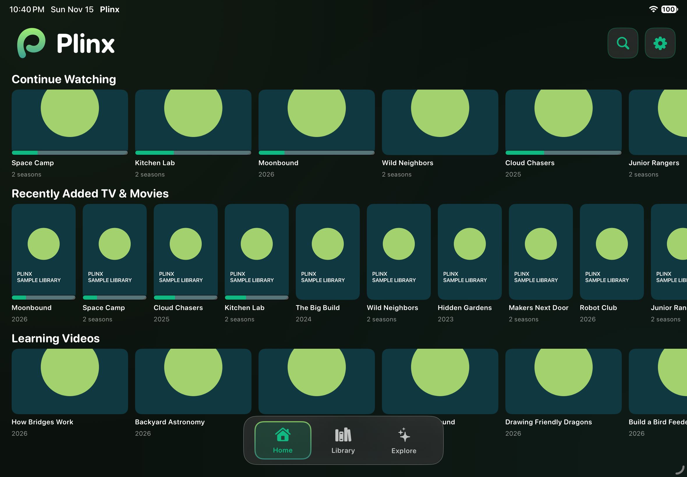
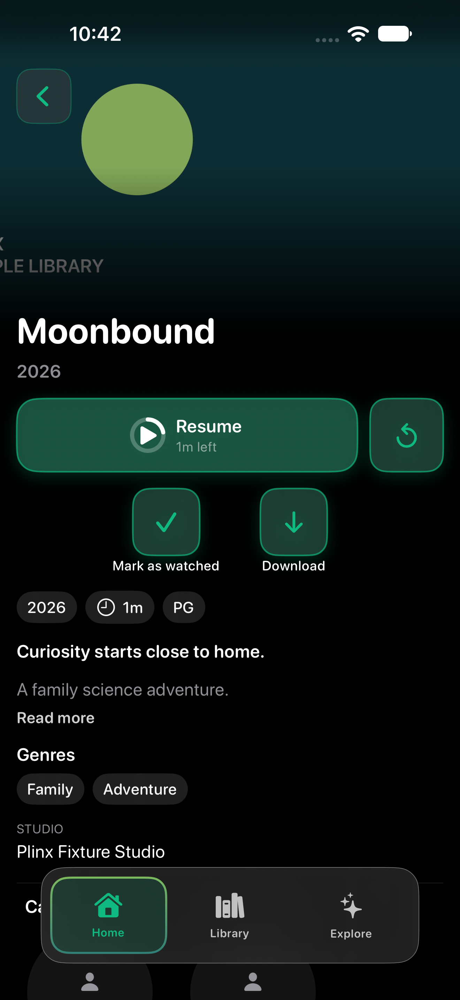
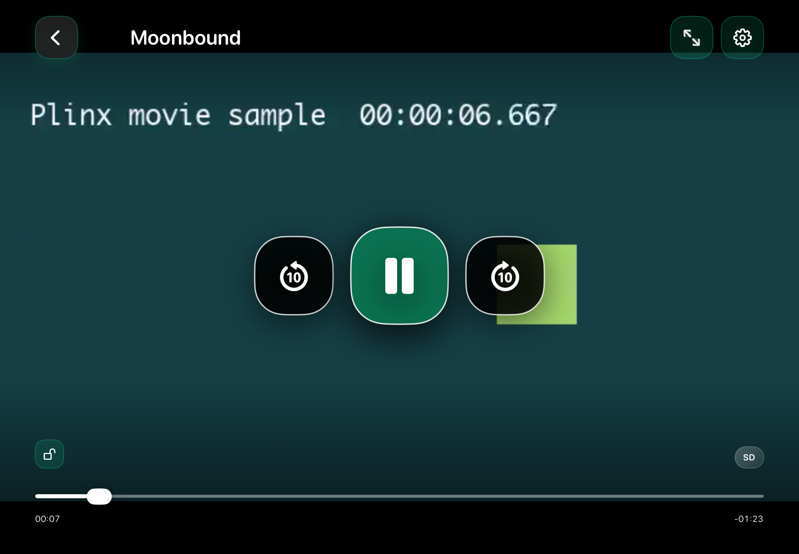

# Product tour

Plinx starts with a parent-managed setup, then offers a focused family media
experience. The app connects to Plex accounts and servers chosen by the family;
it does not provide media or a hosted server.

The screenshots below show the built-in iPhone/iPad demo, using original
sample artwork and bundled abstract videos. They demonstrate the interface;
the titles are sample metadata, not a hosted movie catalog.

## Connect and explore

The connection screen guides parents through account, profile, and server
selection. Open **Sign-in information** to learn about Plex or choose
**Explore the Demo Library** without an account.

## Browse safely

Home, Libraries, and Search show media from the libraries a parent selected.
Movie and television rating ceilings, unrated-media handling, and library
visibility apply before an item is shown and again before playback starts.

## Play and continue watching

Open a title for details, choose an episode when appropriate, and start or
resume playback. Parents can change profile, server, content controls, and
other protected settings through the parental gate.

In landscape on iPhone and iPad, use **Fit** to show the whole video or **Fill**
to cover the screen while cropping the edges. The choice stays in effect when
playback controls hide. Audio and subtitle choices live under the player's
**Tracks** button.

## Optional Youtarr Explore

When a parent configures Youtarr, Explore can show eligible videos and request
status inside Plinx. Plinx applies its active content policy again on-device.
The integration is optional, disabled until configured, and does not place
external YouTube links in kid-facing screens.

## Pick the right device

| Experience | iPhone | iPad | Apple TV |
|---|---:|---:|---:|
| Browse, search, and stream approved media | Yes | Yes | Yes |
| Parent-managed settings and parental gate | Yes | Yes | Yes |
| Optional Youtarr Explore | Yes | Yes | Yes |
| Download for offline playback | Yes | Yes | No |

Use the [downloads guide](downloads-and-offline.md) for offline playback or
the [Apple TV guide](apple-tv.md) for remote navigation.
